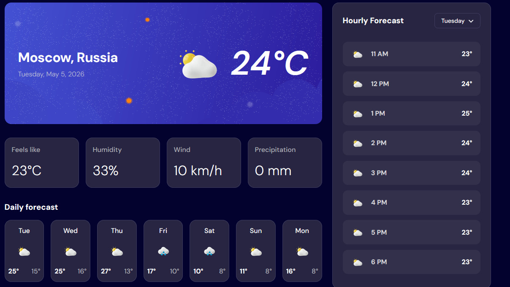
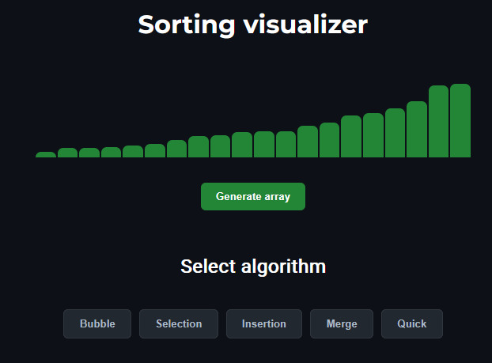
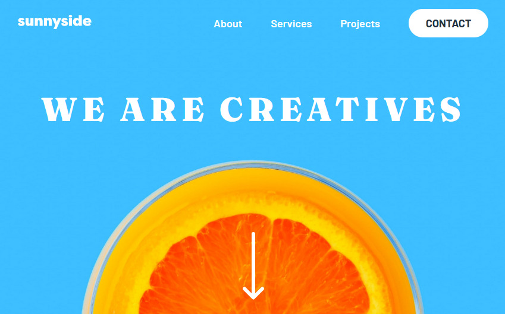

# 👋 Hello!

## 🌟 Interests

-  **Frontend development**
-  **Responsive design**
-  **API integration**
-  **Clean and scalable code**

## 📂 Projects

### 1. ☁️ Weather App
Description: A weather app that fetches data from a public weather API.
- **Tech:** JavaScript, API integration 
- [ Live Demo](https://namemyeyes.github.io/weather-app/)
- **Screenshot:**

  <kbd>
    
  </kbd>

### 2. 📊 Sorting Visualizer
Description: An interactive sorting algorithm visualizer using JavaScript.
- **Tech:** JavaScript, HTML, CSS 
- [ Live Demo](https://namemyeyes.github.io/Sorting-visualizer/)
- **Screenshot:**

  <kbd>
    
  </kbd>

### 3. ☀️ Sunny Side Landing Page
Description: A modern, responsive landing page.
- **Tech:** HTML, CSS, responsive design 
- [ Live Demo](https://namemyeyes.github.io/Sunnyside-agency-landing-page/)
- **Screenshot:**

  <kbd>
    
  </kbd>

